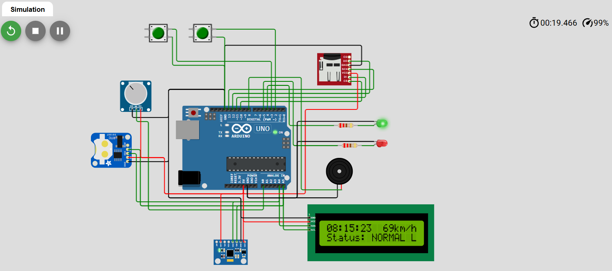
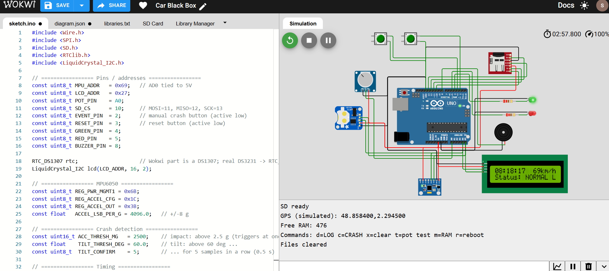
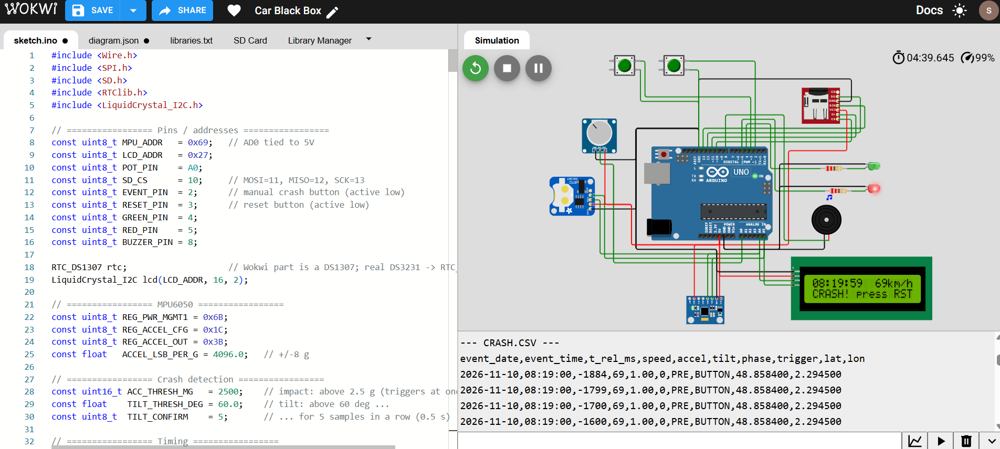

# Car Black Box

A vehicle "black box" prototype for the Arduino Uno. It keeps a rolling 2-second history of speed, acceleration and tilt. When it detects a crash, it saves that history plus the following 2 seconds to an SD card, locks, and raises an alarm.

Built and tested in the [Wokwi](https://wokwi.com) simulator on an Arduino Uno.

> Wokwi project: `<https://wokwi.com/projects/480237314836476929>`

## Demo





## What it does

- Reads acceleration from an **MPU6050** over I2C with direct register reads (no library).
- Reads the time from an **RTC**, speed from a **potentiometer** (0-200 km/h), and shows time, speed and status on a **16x2 I2C LCD**.
- Samples every 100 ms into a **circular buffer** (20 samples, 9 bytes each, 180 bytes total).
- Logs one row per second to `LOG.CSV` on a microSD card.
- Detects a crash from any of three triggers: impact over 2.5 g, tilt over 60° for 0.5 s, or a manual event button.
- On a crash, writes the buffered history (`PRE`, then the triggering sample `TRIG`) and 2 seconds of `POST` samples to `CRASH.CSV`, together with a simulated GPS position.
- Then locks: red LED, beeping buzzer and `CRASH! press RST` on the LCD until the reset button is pressed.

Diagrams, wiring and file formats: [docs/architecture.md](docs/architecture.md).

## Parts

| Part | Used for | Notes |
|---|---|---|
| Arduino Uno | Main board | 2 KB RAM, so the code is written to be memory-lean |
| MPU6050 | Acceleration and tilt | I2C, AD0 tied to 5V so the address is 0x69 |
| DS1307 RTC | Timestamps | This is the part Wokwi provides. A real DS3231 also works: change `RTC_DS1307` to `RTC_DS3231` in the sketch |
| microSD module | `LOG.CSV` and `CRASH.CSV` | SPI |
| 16x2 LCD (I2C) | Time, speed, status | Set `pins = i2c` in Wokwi |
| Potentiometer | Simulated speed | Analog pin A0 |
| 2 pushbuttons | Manual event, reset | Active low with `INPUT_PULLUP` |
| Green and red LED, buzzer | Status and alarm | |

## State machine

```
 NORMAL --(impact / tilt / button)--> RECORDING --(2 s done)--> LOCKED
   ^                                                              |
   +----------------------- reset button -------------------------+
```

## Sample output

`LOG.CSV` (one row per second; the speed follows the potentiometer, and the sliders were at X=1 g, Z=1 g):

```
date,time,speed,accel,tilt
2026-11-10,06:17:12,0,1.41,45
2026-11-10,06:17:13,5,1.41,45
2026-11-10,06:17:14,79,1.41,45
2026-11-10,06:17:15,40,1.41,45
2026-11-10,06:17:16,108,1.41,45
2026-11-10,06:17:17,102,1.41,45
```

`CRASH.CSV` (event triggered with the manual button; rows trimmed with `...`):

```
event_date,event_time,t_rel_ms,speed,accel,tilt,phase,trigger,lat,lon
2026-11-10,08:17:21,-1900,0,1.00,0,PRE,BUTTON,48.858400,2.294500
2026-11-10,08:17:21,-1800,0,1.00,0,PRE,BUTTON,48.858400,2.294500
...
2026-11-10,08:17:21,-100,0,1.00,0,PRE,BUTTON,48.858400,2.294500
2026-11-10,08:17:21,0,0,1.00,0,TRIG,BUTTON,48.858400,2.294500
2026-11-10,08:17:21,141,0,1.00,0,POST,BUTTON,48.858400,2.294500
2026-11-10,08:17:21,241,0,1.00,0,POST,BUTTON,48.858400,2.294500
...
2026-11-10,08:17:21,2041,0,1.00,0,POST,BUTTON,48.858400,2.294500
```

Each event is 19 `PRE` rows, one `TRIG` row and 20 `POST` rows. The `t_rel_ms` values are real `millis()` differences, so they jitter by a few milliseconds around multiples of 100. The two samples above come from separate runs, which is why their clock times differ (the RTC is set from the compile time on every boot in the simulator).

The buffer really holds history. In a test where the potentiometer was turned just before the crash, the speed climbed through the `PRE` rows. This is a selection of rows from an earlier build, before the date, time, `lat` and `lon` columns were added:

```
t_rel_ms,speed,accel,tilt,phase,trigger
-1900,0,1.00,0,PRE,BUTTON
-1800,5,1.00,0,PRE,BUTTON
-1700,7,1.00,0,PRE,BUTTON
-1500,11,1.00,0,PRE,BUTTON
-800,14,1.00,0,PRE,BUTTON
0,14,1.00,0,TRIG,BUTTON
```

## Tested behaviour (Wokwi simulation)

| Test | Result |
|---|---|
| Rest (0, 0, 1 g) | 1.00 g, 0°, flag OK |
| X=2 g, Z=1 g | 2.24 g, 63.4°, TILT |
| X=2 g, Z=2 g | 2.83 g, IMPACT |
| Tilt crash | Triggered after 5 tilted samples; `PRE` rows show 0° then 63° for the last 400 ms |
| Button crash | 19 `PRE` + 1 `TRIG` + 20 `POST` rows |
| Several crashes | Events appended to one `CRASH.CSV`, single header |
| Reboot (software reset) | Old rows kept, header not repeated, new rows appended |
| Crash right after reset | Only 4 `PRE` rows: the buffer is cleared on reset, no stale data |
| Speed history | `PRE` rows show the potentiometer movement before the crash |
| Buttons | One crash per event press, one reset per reset press (30 ms debounce) |
| Memory (Uno, 2048 bytes) | 476 bytes free at boot, 336 bytes lowest seen during a crash |

## Run it

1. Create a new **Arduino Uno** project on [wokwi.com](https://wokwi.com) and build the circuit from the [wiring table](docs/architecture.md#wiring-wokwi--arduino-uno). Use the LCD part with `pins = i2c`, and set the MPU6050's AD0 to 5V.
2. Add the libraries listed in `wokwi/libraries.txt` (RTClib, LiquidCrystal I2C).
3. Paste `src/car_black_box/car_black_box.ino` into `sketch.ino` and run it.
4. Use the MPU6050 sliders and the potentiometer to drive it, and the Serial monitor to read the files.

Serial monitor commands (enabled by `DEBUG_COMMANDS 1` in the sketch): `d` prints `LOG.CSV`, `c` prints `CRASH.CSV`, `x` clears both files, `t` arms a test crash 1.5 s after the potentiometer moves, `m` prints free RAM, `r` reboots.

## Repository layout

```
car-black-box/
├── src/car_black_box/car_black_box.ino   Arduino sketch
├── wokwi/libraries.txt                   libraries to add in Wokwi
├── docs/                                 architecture.md, images/
└── README.md
```

## Known limitations

- **Simulation only.** Nothing here has run on real hardware, and the crash thresholds (2.5 g, 60°) are reasonable guesses, not calibrated against real crash data.
- **Wokwi's SD card is not persistent.** Restarting the simulation creates a fresh card, while a software reset inside a running simulation (Serial `r`) keeps the files. Files written by the sketch could not be downloaded, so they are read back over Serial.
- **The RTC is set from the compile time on every boot.** That is fine in the simulator, but on real hardware it must only be set once.
- **Sampling jitter.** The sampler uses fixed deadlines, so it does not drift, but individual samples land up to roughly 25 ms late when the LCD or SD is busy.
- **GPS is a constant.** Position is a fixed fake value, not live data. Wokwi has no official NEO-6M part.
- **Tight on memory.** On the Uno, the lowest free RAM seen was 336 bytes, and the SD library's own stack use is not included in that figure. This also limits the history to 2 seconds.

## Porting to STM32 Discovery (DISC1)

This project is written for the Arduino Uno, but the design can be moved to an STM32 Discovery board (DISC1). The state machine, circular buffer, crash triggers and CSV formats don't depend on the board. Only the hardware layer changes. No STM32 code is included in this repository. This section lists what to expect.

**What you gain**
- **Much more RAM and flash.** The Uno's 2 KB limits the history to 2 seconds. An STM32 could keep 10 seconds or more (for example 100 samples of 9 bytes is 900 bytes).
- **A hardware timer for sampling.** The 100 ms tick comes from a timer interrupt, which removes the late-sample jitter listed above.
- **A real ADC, DMA and more peripherals**, and a proper debugger through the on-board ST-LINK.
- **More embedded skills practised:** I2C, SPI, timers, interrupts and FatFS.

**Challenges and limitations**

| Area | What changes or goes wrong |
|---|---|
| **No simulation** | Wokwi can't simulate the Discovery board (its official STM32 boards are Nucleo ones), so the port has to be tested on real hardware. You need to buy the MPU6050, RTC and SD module, and wire them yourself. |
| **SD card** | The Arduino `SD` library becomes **SPI + FatFS**. CubeMX does not generate an SD-over-SPI disk driver, so you must write or port the `disk_*` functions (`disk_initialize`, `disk_read`, `disk_write`, and so on). This is usually the hardest part. |
| **Arduino functions disappear** | There is no `Wire`, `millis()`, `analogRead()` or `tone()`. Use HAL I2C, `HAL_GetTick()`, the ADC peripheral and a PWM timer channel for the buzzer. |
| **I2C addresses** | HAL wants the 8-bit address (7-bit shifted left by one): MPU6050 `0x69` becomes `0xD2`, RTC `0x68` becomes `0xD0`, LCD backpack `0x27` becomes `0x4E`. |
| **Interrupt rules** | The timer interrupt should only set a flag. I2C, SPI and FatFS calls are blocking and slow, so they must run in the main loop, not in the ISR. |
| **Flush behaviour** | `file.flush()` becomes `f_sync()` after each row. Without it, a power loss during a crash loses the data. |
| **Voltage levels** | Discovery boards run at 3.3 V logic, and not every pin is 5 V tolerant. Check that your MPU6050, RTC and SD modules work at 3.3 V. |
| **Pin conflicts** | Discovery boards route many pins to on-board parts (sensors, audio, USB). Check your board's user manual for free pins and for what the on-board accelerometer is. |
| **RTC** | The on-chip RTC needs its backup domain set up (and ideally a battery). Whichever RTC you use, set the time once, not on every boot. |
| **Tooling and debugging** | CubeMX, HAL and the ST-LINK toolchain take longer to learn than the Arduino IDE. There is no Serial monitor out of the box: you set up a UART for `printf` yourself. |

**Suggested order if you try it:** blink an LED and print over UART, scan I2C, read the MPU6050, add the timer tick and the crash logic, then SD with FatFS, then buttons, LEDs and buzzer, and last the RTC and LCD.
