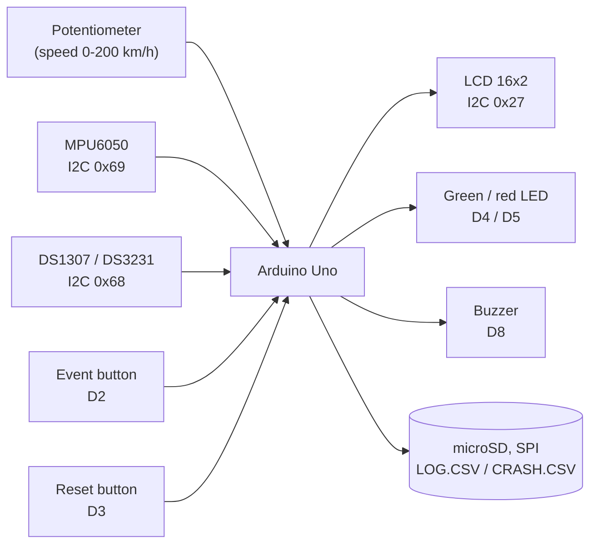
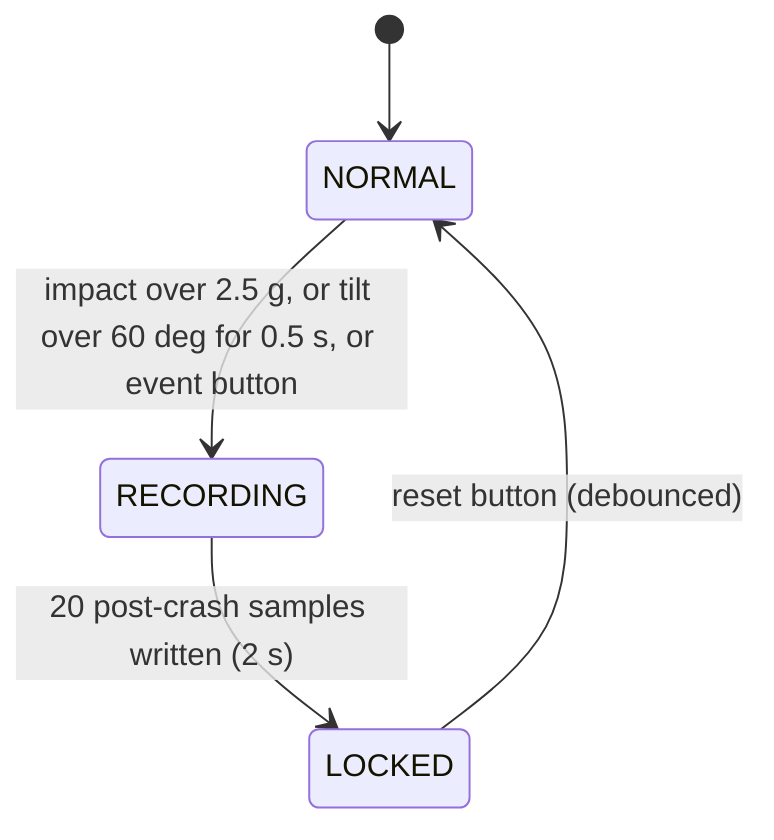
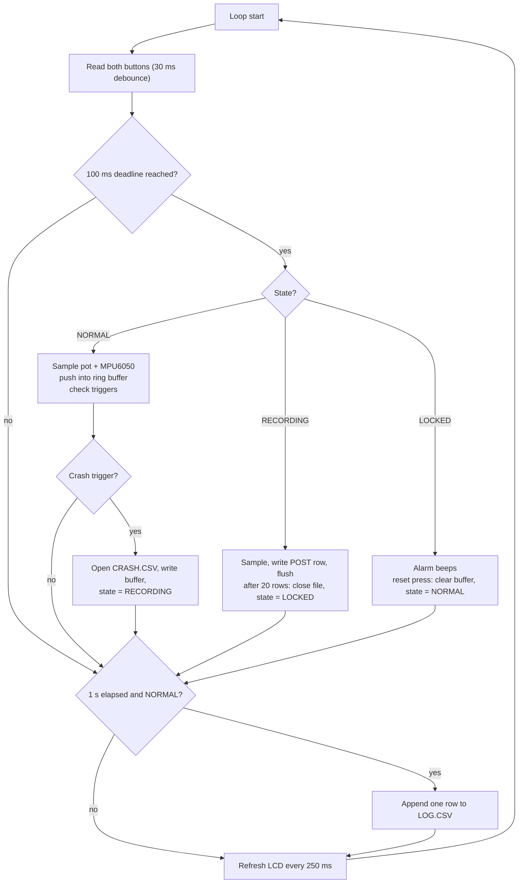

# Architecture

The diagrams below are Mermaid, which GitHub renders directly in the browser.

## Block diagram



## State machine



| State | What happens |
|---|---|
| NORMAL | Sample every 100 ms into the circular buffer. Green LED on. One row per second to `LOG.CSV` |
| RECORDING | Red LED on. Dump the buffer (19 PRE rows + 1 TRIG row) to `CRASH.CSV`, then write each of the next 20 samples (POST rows), flushing every row. LCD: `CRASH! recording` |
| LOCKED | Logging stopped, red LED on, buzzer beeps 300 ms on / 300 ms off. LCD: `CRASH! press RST`. Reset clears the buffer and returns to NORMAL |

## Main loop



## Crash triggers

| Trigger | Condition |
|---|---|
| IMPACT | Acceleration magnitude above 2.5 g. Fires on the first sample |
| TILT | Tilt from vertical above 60 degrees for 5 samples in a row (0.5 s), so a brief swerve is ignored |
| BUTTON | Debounced press of the manual event button |

If several are true at once the priority is IMPACT, then BUTTON, then TILT.

## Circular buffer

Each sample is a packed 9-byte struct (timestamp 4, acceleration in milli-g 2, speed 1, tilt 1, flags 1). Twenty samples take 180 bytes and cover the last 2 seconds at 100 ms. The triggering sample is pushed into the buffer before the dump, so it appears as the `TRIG` row.

## Wiring (Wokwi / Arduino Uno)

| Part | Connection |
|---|---|
| MPU6050 | SDA A4, SCL A5, AD0 to 5V (address 0x69) |
| DS1307 / DS3231 RTC | SDA A4, SCL A5 (address 0x68) |
| LCD 16x2 (I2C) | SDA A4, SCL A5 (address 0x27) |
| microSD | CS D10, MOSI D11, MISO D12, SCK D13 |
| Potentiometer (speed) | SIG A0 |
| Event button | D2 to GND (INPUT_PULLUP, active low) |
| Reset button | D3 to GND (INPUT_PULLUP, active low) |
| Green LED | D4 through 220 ohm |
| Red LED | D5 through 220 ohm |
| Buzzer | D8 |

## File formats

`LOG.CSV`, one row per second in NORMAL:

```
date,time,speed,accel,tilt
```

`CRASH.CSV`, one block of 40 rows per crash. `event_date` and `event_time` are the crash instant and the same on every row of one event. `t_rel_ms` is the time relative to the triggering sample, so PRE rows are negative:

```
event_date,event_time,t_rel_ms,speed,accel,tilt,phase,trigger,lat,lon
```

`lat` and `lon` are a fixed simulated position (`GPS_LAT_E6`, `GPS_LON_E6` in the sketch).
